  

  
  

 

### `> right now`

- **Agency Zero.** The CRM and operating system I run my agency on: clients, quotes, contracts, invoices and a calendar in one app.
- **Claude skills for marketers.** [SEO God Mode](https://github.com/F0rger123/CLAUDE-SEO-GOD-MODE) and [Meta Ads God Mode](https://github.com/F0rger123/claude-meta-ads-god-mode) turn Claude into an SEO lead and a paid-media operator that can't spend money by accident.
- **CRMs for real businesses.** Field-service CRMs for cleaning, lighting and remodeling companies, built on one starter that an AI agent customizes per client.
- **LifeSteal.** An Android app that blocks the feeds, plans your day and shows how much time you took back.
- **Jarvis.** Merging the best open-source Jarvis assistants into one free, local-first assistant.

### `> featured`

<table>
  <tr>
    <td width="50%" valign="top"></td>
    <td width="50%" valign="top"></td>
  </tr>
  <tr>
    <td width="50%" valign="top"></td>
    <td width="50%" valign="top"></td>
  </tr>
  <tr>
    <td width="50%" valign="top"></td>
    <td width="50%" valign="top"></td>
  </tr>
  <tr>
    <td width="50%" valign="top"></td>
    <td width="50%" valign="top"></td>
  </tr>
</table>

Plus private client work: CRMs, a retro arcade football game, and an Android life OS.

### `> toolbox`

### `> stats`

  
  

<picture>
  <source media="(prefers-color-scheme: dark)" srcset="https://raw.githubusercontent.com/F0rger123/F0rger123/output/snake-dark.svg">
  
</picture>

<code>// built with claude code · always shipping</code>

